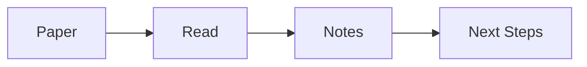

# Markdown & Wikilinks

Agentero notes are plain Markdown files. You can edit them inside the app or with any external editor.

## Basic Markdown

```markdown
# Heading 1

## Heading 2

- bullet
- another bullet

1. numbered
2. numbered

**bold**, *italic*, `inline code`
```

```rust
// code block
// Click the top-right button to switch language or copy code
```

> [!NOTE]
> Obsidian-style callouts are supported.

Callouts render with icons and theme colors. Click the title or icon to edit the type and title inline. Supported types include `note`, `tip`, `info`, `warning`, `danger`, `success`, `question`, `quote`, `example`, and `failure`.

## Math

Inline math: `$E=mc^2$`

Block math:

```markdown
$$\int_a^b f(x) dx$$
```

> [!TIP]
> Typing `\$a\$` keeps it as plain text; `$a$` is rendered as math.

## Slash Commands

Type `/` in the editor to open a lightweight command menu. Use the arrow keys to navigate and `Enter` to insert. Commands include headings, lists, todos, quotes, code blocks, diagrams, links, and callouts.

Common commands:

| Command        | Inserts                                        |
| -------------- | ---------------------------------------------- |
| `/mermaid`     | A live-rendered Mermaid diagram                |
| `/code`        | A code block (pick a language from the selector) |
| `/callout`     | An Obsidian callout (`note` type by default)   |
| `/link`        | An internal wikilink `[[]]`                    |
| `/heading 1–3` | A heading block                                |

> [!NOTE]
> `/` must be at the start of a line or after a space. It does not trigger inside code blocks or when a wikilink completion menu is open.

## External links

Standard Markdown links work in the editor:

```markdown
[Agentero site](https://example.com)
```

Type the full `[label](url)` form (the closing `)` turns it into a link), paste the same syntax, or use the context menu / slash command **Add external link** — that inserts a link node with a placeholder label and opens the edit bubble for display text and URL. Click an existing link to edit; **⌘/Ctrl+click**, middle-click, or right-click opens it in your system browser. Relative links to other vault notes use in-app navigation instead.

## Mermaid Diagrams

Use `/mermaid` or select **Mermaid** from a code block's language selector. The diagram preview appears below the source code:



> [!TIP]
> Mermaid diagrams are read-only previews. Edit the source code above to update the diagram.

## Wikilinks

Double brackets can link to Markdown notes or PDFs. The meaning of `#` depends on the target format:

| Target | `#` rule | Example |
|---|---|---|
| Markdown note | Heading text; multiple `#` separators form a nested heading path | `[[note.md#Experiments#Dataset]]` |
| PDF | Section number | `[[paper.pdf#2.1]]` |
| PDF paragraph | Section number followed by `#pN`, the Nth body block in that section | `[[paper.pdf#2.1#p3]]` |

### Markdown notes

The `.md` extension is optional. Include the extension or a Vault-relative path when names are ambiguous:

```markdown
[[01 Papers and Import]]
[[01 Papers and Import.md#Library]]
[[01 Papers and Import#Import Methods#Zotero Connector]]
```

Type `[[note#` to search headings, then another `#` to choose a child heading. Use the full nested path, or omit leading ancestors when the remaining consecutive heading path is unique.

### PDF sections and paragraphs

Keep the `.pdf` extension. `#2` and `#2.1` refer to section numbers; `#2.1#p3` refers to the third body block in Section 2.1. Here, `p3` does not mean page 3:

```markdown
[[papers/demo/demo.pdf#2]]
[[papers/demo/demo.pdf#2.1]]
[[papers/demo/demo.pdf#2.1#p3|Supporting paragraph]]
```

Type `[[paper.pdf#` to search numbered sections by title using the PDF layout analysis. With a section selected, **Enter** confirms the section link; **Tab** completes `paper.pdf#2.1#` and continues to that section's paragraphs. Paragraph candidates show source text so you can check the target.

PDF layout analysis must already be available. Paragraphs count body blocks directly owned by the section; subsections count separately. A block may differ from a natural paragraph, so prefer completion over guessing. Missing analysis, missing targets, or ambiguity produces an error. Legacy `[[paper.pdf#section=2.1]]` and `[[paper.pdf#page=3]]` still work. Standard Markdown links accept the same PDF fragments:

```markdown
[Section 2.1, paragraph 3](papers/demo/demo.pdf#2.1#p3)
```

### Annotations and display names

Use `@` for PDF highlights and visual annotations. Copy the `id` from the Annotations panel, or type `[[@` to open completion:

```markdown
[[@annotationId]]
[[papers/…/NOTES@annotationId|Paper title]]
```

- `#`: Markdown heading or PDF section/paragraph; `^`: Markdown text block; `|`: display name; `@`: annotation.
- Annotation targets must use a path (`NOTES`, `paper.pdf`, or `papers/…/NOTES`), not only the paper's display title.

Wikilinks support internal navigation and backlinks. The citation graph in References uses paper references separately from Markdown wikilinks.

## Embeds

Prefix a wikilink with `!` to embed its content:

```markdown
![[01 Papers and Import#Library]]
![[papers/demo/demo.pdf#2.1#p3]]
![[papers/…/NOTES@annotationId]]
```

You can embed:

- **Note sections** — `![[note#Section#Subsection]]`
- **Images** — `![[diagram.png]]` or ``
- **Whole PDFs** — `![[paper.pdf]]`
- **PDF sections / paragraphs** — `![[paper.pdf#2.1]]` / `![[paper.pdf#2.1#p3]]`
- **PDF annotation previews** — `![[…@annotationId]]`

PDF section and paragraph embeds fit the container width, navigate to the target, and keep a subtle highlight visible. Section links highlight the heading block; paragraph links highlight the body block. After scrolling away, click **Return to cited location**, the icon to the left of Open in the header.

Markdown sections and annotation previews are read-only; open the source to edit them. **An embedded primary paper PDF supports highlights, comments, colour changes, deletion, and visual annotations**, using the same paper `marks/` data as the main reader. Viewers in the same window synchronize changes. Comment cards appear inside the embedded page on hover or while editing. Other PDF attachments keep basic reading mode and do not use the primary paper's annotations.

## Images

Paste an image into a Markdown note and Agentero stores it under the note's `assets/` folder:

```markdown

```

If an image is no longer referenced, it is cleaned up automatically.

## Next

- [[02 Agent and Skills]]
- [[01 Papers and Import]]
